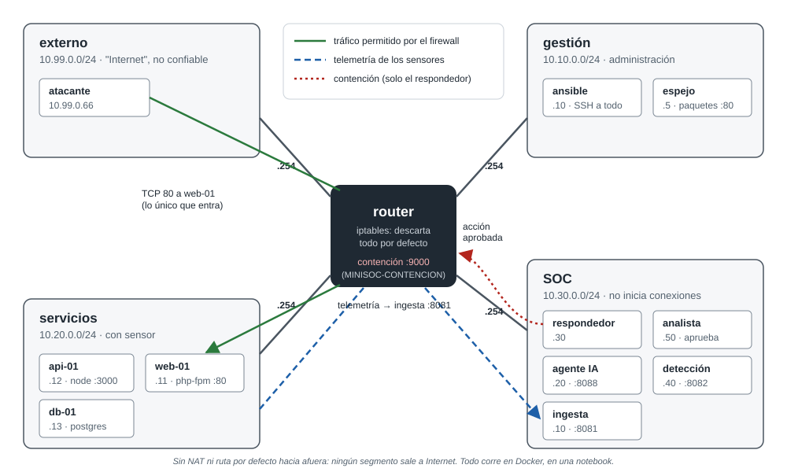

# MiniSOC-IA

**TP4 — Proyecto Integrador · Gestión Operativa y Seguridad en Redes · UTN FR La Plata**
Grupo 13: Juan Bautista Aramberri · Tomás Costa · Joaquín Mazza · Modalidad A (Proyecto de Desarrollo)

Un centro de operaciones de seguridad (SOC) a escala de laboratorio. Detecta un ataque,
lo investiga con un modelo de lenguaje local y lo contiene en la red **solo después de que
lo aprueba una persona**. Corre entero en una notebook, sin Internet.



## Entregables

| Qué | Dónde |
|---|---|
| Documento (7 páginas) | [`documento/documento.pdf`](documento/documento.pdf) · fuente en [`documento.md`](documento/documento.md) |
| Póster A1 | [`poster/poster.pdf`](poster/poster.pdf) · editable en [`poster.html`](poster/poster.html) |
| Demo | [`demo/`](demo/README.md) |
| Capturas y evidencias | [`capturas/`](capturas/README.md) |
| Bitácora del grupo | [`progreso.md`](progreso.md) |
| Consigna de la cátedra | [`CONSIGNA.md`](CONSIGNA.md) |

## Reproducirlo

Hace falta Docker con Compose v2 (Docker Desktop en Windows, con Git Bash). Desde `demo/`:

```bash
./ansible/ejecutar.sh      # construye, levanta y verifica todo (la 2.ª corrida da changed=0)
./demo.sh                  # la demo de la Feria, paso a paso
```

Grafana queda en <http://127.0.0.1:3000>. Por defecto el agente usa un modelo simulado,
sin GPU. Para Llama 3.1 8B local (GPU NVIDIA) y para dejar la notebook lista para
correr sin Internet, ver [`demo/offline/`](demo/offline/README.md).

Para regenerar los PDF después de editar el documento o el póster:

```bash
pip install markdown
python documento/generar_pdf.py
```

## Tecnologías

| Área | Qué usamos |
|---|---|
| Redes | Docker Compose: cuatro segmentos sin NAT, router Alpine con `iptables` y contención por API |
| Operación | Ansible (en un contenedor de control), Prometheus y Grafana |
| Seguridad | Reglas MITRE ATT&CK, aprobación humana con tokens por rol, ledger con hash encadenado (HMAC) |
| IA | Ollama con Llama 3.1 8B local; el agente valida cada respuesta del modelo |
| Lenguaje | Python 3 (biblioteca estándar en los servicios), Bash |

## Estructura

```
├── documento/    documento final (PDF + Markdown) y el script que genera los PDF
├── poster/       póster A1 (HTML + PDF), imágenes y guía de la cátedra
├── demo/         laboratorio, servicios, Ansible, monitoreo y demo
├── capturas/     evidencias de la demo, Grafana y pruebas de red
├── diagramas/    topología del laboratorio
├── templates/    templates de la cátedra
└── progreso.md   bitácora del grupo
```
