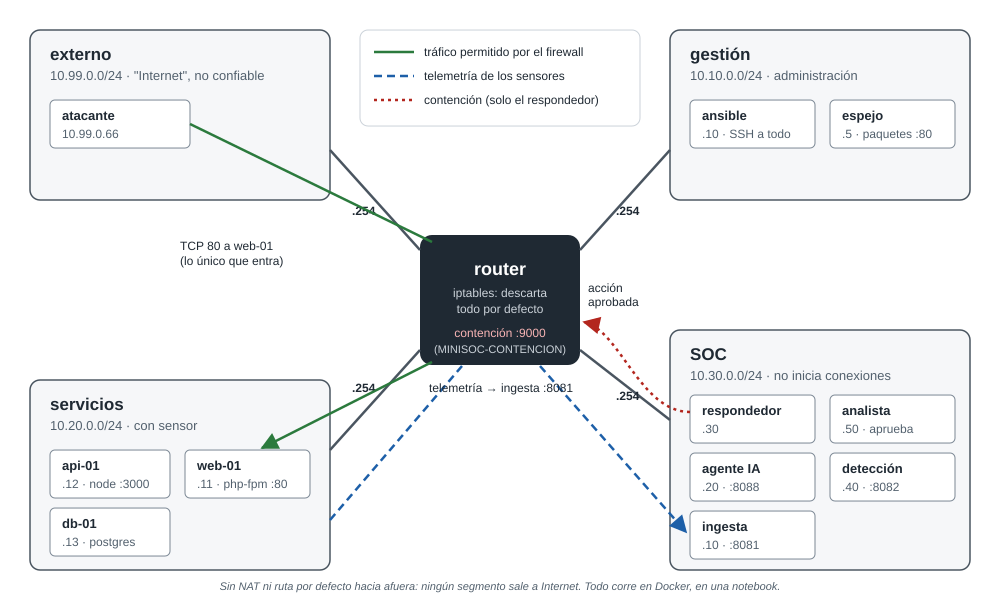
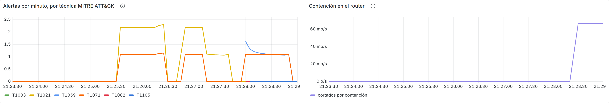

# MiniSOC-IA: centro de operaciones de seguridad asistido por IA sobre una red segmentada, automatizada y monitoreada


**Universidad Tecnológica Nacional** — Facultad Regional La Plata

**Carrera:** Ingeniería en Sistemas de Información

**Cátedra:** Gestión Operativa y Seguridad en Redes

**Trabajo Práctico N.º 4** — Proyecto Integrador

**Modalidad:** A — Proyecto de Desarrollo

**Grupo:** 13

**Integrantes:**
- Aramberri, Juan Bautista
- Costa, Tomás
- Mazza, Joaquín

**Fecha de entrega:** 17/11/2026

---

## 1. Resumen ejecutivo

Un SOC (*Security Operations Center*) recibe muchas más alertas de las que un equipo
puede revisar. En octubre de 2026, PHP2Shell y Node2Shell se explotaron a horas de su
divulgación: el cuello de botella no es parchear, sino **ver a tiempo** qué pasó. Un
modelo de lenguaje (LLM) puede acelerar el análisis, pero puede afirmar algo sin
evidencia o actuar sobre la red sin supervisión.

**MiniSOC-IA**, inspirado en AiSOC (licencia MIT), es un SOC de laboratorio que
detecta, investiga y propone la contención de incidentes, con decisiones auditables y
aprobación humana. Integra las tres áreas de
la materia. En **Redes**, cuatro segmentos de Docker unidos por un router con firewall,
sin salida a Internet. En **Operación**, Ansible despliega todo de forma idempotente, y
Prometheus y Grafana miden la red y el SOC. En **Seguridad**, reglas de detección
mapeadas a MITRE ATT&CK y una contención que es una regla de red, aplicada solo después
de que un analista la aprueba. Un agente con un LLM local (Llama 3.1 8B) da el
veredicto citando los eventos, y cada paso queda en un *ledger* auditable.

Las 44 pruebas de red pasan. En la notebook de la Feria, el veredicto llega unos 70 s
después del ataque y el bloqueo aprobado se aplica en menos de 2 s. Los controles sobre el modelo
llevaron de 15 a 0 los ataques que el agente cerraba solo como benignos. No se usan
exploits reales: se simula la telemetría que dejarían, en una red aislada (Ley 26.388).

## 2. Arquitectura de la solución

### 2.1. Diagrama de red



*Figura 1: Topología del laboratorio. Todo el tráfico entre segmentos pasa por el router.*

### 2.2. Componentes

Tabla 1: Componentes de la solución

| Componente | Tecnología | Función |
|------------|------------|---------|
| Router, firewall y respondedor | Alpine Linux + iptables, Python 3 | Une los segmentos, descarta lo no permitido y aplica las contenciones aprobadas |
| Sensor | Python 3, lectura de `/proc` | En cada servicio, reporta procesos y conexiones TCP nuevos, sin privilegios |
| Ingesta | Python 3 + SQLite | Valida y normaliza la telemetría; exige que cada sensor envíe desde su IP |
| Detección y correlación | Python 3 + SQLite | 9 reglas MITRE ATT&CK; agrupa las alertas por host en incidentes |
| Agente de triage y ledger | Python 3 + Ollama (Llama 3.1 8B), JSONL con HMAC | Valida el veredicto del modelo, deja las acciones para aprobar y registra cada paso |
| Automatización | Ansible en un contenedor de control | Prepara, levanta y verifica el laboratorio con un solo comando |
| Monitoreo | Prometheus + Grafana | Métricas de la red y del SOC cada 5 s, 11 alertas y un dashboard |

### 2.3. Flujo de datos

1. El **sensor** de `web-01` ve que `php-fpm` lanzó `sh -c id` y lo manda a la
   **ingesta** (`:8081`), el único tráfico permitido de servicios al SOC.
2. La **detección** dispara `T1059` (un servicio lanzó un shell) y la **correlación**
   lo suma al incidente de `web-01`, que manda al agente tras 20 s sin alertas nuevas.
3. El **agente** valida el veredicto del modelo (sección 3.2) y el **respondedor**
   aplica en el router la acción que aprueba el analista.

## 3. Implementación

### 3.1. Configuración de red

El router descarta todo por defecto. Las reglas usan subredes, porque Docker no
garantiza el orden de las interfaces.

Tabla 2: Tráfico permitido entre segmentos (todo lo demás se descarta)

| Origen | Destino | Permitido |
|--------|---------|-----------|
| gestión | servicios y SOC | SSH (22) e ICMP |
| servicios | espejo `10.10.0.5` · ingesta `10.30.0.10` | HTTP (80) · telemetría (8081) |
| externo | `web-01` `10.20.0.11` | HTTP (80), el único servicio publicado |
| respondedor `10.30.0.30` | router `10.30.0.254` | contención (9000) |
| SOC | otros segmentos | nada: no inicia conexiones |

```bash
-A FORWARD -j MINISOC-CONTENCION      # bloqueos del respondedor, antes que todo
-A FORWARD -m conntrack --ctstate ESTABLISHED,RELATED -j ACCEPT
-A FORWARD -m conntrack --ctstate NEW -j MINISOC-PERMITIDO
-A FORWARD -j MINISOC-DENEGADO        # contadores de lo descartado
```

**Sin salida a Internet.** Las redes no hacen NAT, cada nodo sale por el router y el
router no tiene ruta por defecto. Una ruta `prohibit` impide llegar al host por el
*bridge* de Docker.

### 3.2. Container networking

Los contenedores corren sin capacidades extra (`cap_drop: ALL`), como un usuario sin
privilegios, con el sistema de archivos de solo lectura y sin puertos publicados.

**Contención.** El router expone un servicio que solo atiende a la IP del respondedor,
con token, y traduce dos acciones a reglas fijas, sin pasar por un shell:
`bloquear_ip` descarta el tráfico de una IP, y `aislar_host` corta todo el de un host,
salvo el SSH desde gestión y la telemetría. Rechaza actuar sobre el SOC, y cada regla
lleva el identificador de la acción, para revertirla con exactitud.

**Agente de IA.** El agente no tiene acceso a la red ni al router: solo propone
acciones. El modelo se trata como una fuente que puede equivocarse o ser manipulada, y
su respuesta se contrasta con el incidente (Tabla 3); si algo no cierra, va a revisión
humana.

Tabla 3: Controles sobre la respuesta del modelo

| Riesgo | Control |
|--------|---------|
| Cita eventos que no existen | Cada evidencia se busca en el incidente |
| Propone una acción indebida o pedida por un log (inyección) | Solo `aislar_host` y `bloquear_ip`, sobre objetivos del incidente y nunca sobre el router o el SOC |
| Descarta un ataque real | Un veredicto benigno sobre alertas altas no se cierra solo |
| Responde mal o duda | Veredicto `indeterminado` |

Enviar incidentes, aprobar y ejecutar requieren tres tokens distintos, así que ningún
componente completa el ciclo solo. Cada paso queda en un *ledger* donde cada entrada
guarda el hash de la anterior: modificar, borrar o cortar una línea rompe la cadena.

### 3.3. Automatización

Un solo comando, `./ansible/ejecutar.sh`, prepara, levanta y verifica el laboratorio.
Ansible corre en un contenedor de control que maneja el Docker de la notebook por su
socket; ese contenedor no está en ninguna red del laboratorio. El *playbook* tiene tres
roles: `preparacion` (tokens del `.env` y modelo del agente), `laboratorio` (construye,
levanta y espera los *healthchecks*) y `verificacion` (pruebas de red, ledger y
dashboard). La segunda corrida termina con `changed=0`.

Con Llama, levanta Ollama en el SOC (`10.30.0.70`) con la GPU. Para la Feria, sin
Internet, `offline/` baja antes las imágenes y los modelos.

### 3.4. Monitoreo

Prometheus lee cada 5 s las métricas del router, la ingesta, la detección, el agente y
el respondedor. Va en el segmento SOC, junto a lo que mide, para no cruzar el router.
El router publica los contadores de `iptables` solo para la IP de Prometheus. Grafana
carga el dashboard desde el repo, y 11 alertas cubren servicios caídos, el ledger roto,
errores del modelo y acciones sin aprobar.



*Figura 2: Grafana durante la demo: alertas por técnica (T1059 es el webshell) y
paquetes cortados en el router después de aprobar la contención.*

## 4. Verificación

### 4.1. Pruebas de conectividad

`red/verificar.sh` corre 44 pruebas desde los contenedores (rutas, 32 conexiones y
lectura de Prometheus), que distinguen *abierto*, *rechazado* y *bloqueado*. Todas pasan.

### 4.2. Pruebas de segmentación

Tabla 4: Segmentación y contención, probadas en el laboratorio

| Desde | Hacia | Esperado | Resultado |
|-------|-------|----------|-----------|
| `web-01` | gestión · SOC · Internet · bridge de Docker | bloqueado | ✔ |
| atacante | `api-01:3000` · gestión · SOC | bloqueado | ✔ |
| SOC | servicios · gestión · Internet | bloqueado | ✔ |
| `web-01` comprometido | mandar eventos como `db-01` | rechazado (403) | ✔ |
| atacante → `web-01:80`, tras `bloquear_ip` | — | bloqueado; `web-01` → espejo sigue abierto | ✔ |

Las 66 pruebas del agente cubren los controles de la Tabla 3. Con 16 incidentes
etiquetados, el prompt inicial habría cerrado sin revisión **15 de 36 errores**; con los
controles, **0**. Ningún modelo resistió la inyección de prompt: la frenaron los
controles.

### 4.3. Pruebas de automatización

Tabla 5: Corridas de Ansible y del modo offline

| Prueba | Resultado |
|--------|-----------|
| Segunda corrida · `--check` | `changed=0`; con `--check` no toca nada |
| Pasar a Llama y volver al simulado | levanta y apaga Ollama; 44 OK y 41 OK con 3 omitidas |
| Exportar e importar en otra notebook | hashes OK y el 8B responde en la GPU |
| Llama 3.1 8B en la 1660 Ti de la Feria | 5,6 GB, 75 % en GPU · ~45 s por veredicto |

## 5. Limitaciones y trabajo futuro

- **Red y detección:** dentro de un segmento no hay filtrado, así que `aislar_host`
  no corta el tráfico con los vecinos (haría falta microsegmentación). El sensor
  muestrea cada 50 ms y puede perder procesos cortos (un sensor eBPF lo resolvería).
- **Agente y operación:** los modelos chicos se equivocan seguido, y en 6 GB el 8B no
  entra entero en la GPU. Ansible maneja una sola notebook, y sin Alertmanager las
  alertas solo se ven en el dashboard.

## 6. Conclusiones

Lo que hizo seguro al sistema no fue el modelo, que se equivoca y obedece texto
inyectado, sino los controles que lo rodean y la aprobación humana. Medir antes y
después de cada cambio permitió llevar a cero los errores que el agente cerraba solo.
Un despliegue idempotente y monitoreado permite reconstruir y comprobar la demo con un
solo comando.

Trabajo: Aramberri, red, detección y respuesta; Mazza, agente de IA y ledger; Costa,
automatización, monitoreo y póster.

## 7. Referencias

- beenuar. (2026). *AiSOC: Open-source AI Security Operations Center*. Recuperado de https://github.com/beenuar/AiSOC
- MITRE. (2026). *MITRE ATT&CK*. Recuperado de https://attack.mitre.org/
- CISA. (2026). *Known Exploited Vulnerabilities Catalog*. Recuperado de https://www.cisa.gov/known-exploited-vulnerabilities-catalog
- Ollama. (2026). *Ollama API: structured outputs*. Recuperado de https://github.com/ollama/ollama/blob/main/docs/api.md
- OWASP. (2025). *OWASP Top 10 for LLM Applications: LLM01 Prompt Injection*. Recuperado de https://genai.owasp.org/llmrisk/llm01-prompt-injection/
- IETF. (1997). *RFC 2104: HMAC: Keyed-Hashing for Message Authentication*. Recuperado de https://datatracker.ietf.org/doc/rfc2104/
